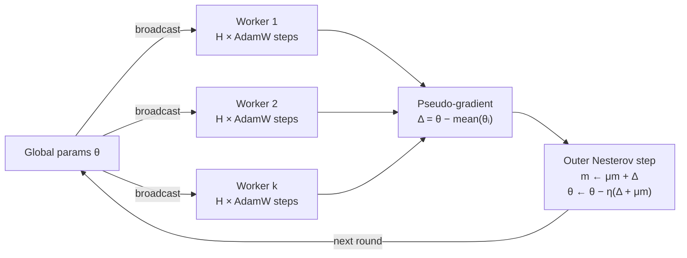

# DiLoCo from Scratch

**Distributed Low-Communication training, implemented in ~450 lines of pure NumPy. No PyTorch, no autograd, no frameworks.**

> Workers train on their own for many steps and sync only once per round. In the bundled demo that cuts communication by **20×** and still matches a baseline that syncs every step: **90.0% vs 88.8%** held-out accuracy.


**[📖 Read the step-by-step build walkthrough →](https://soorya38.github.io/distributed-low-communication-training-of-language-models/)**

This repo reimplements the core algorithm from [DiLoCo: Distributed Low-Communication Training of Language Models](https://arxiv.org/abs/2311.08455) (Douillard et al., Google DeepMind, 2023) from first principles. Every gradient, optimizer moment, and parameter update is written by hand, so you can read exactly what the algorithm does.

---

## Why this matters

Data-parallel training usually all-reduces gradients **after every step**. That only works when every accelerator sits on the same fast interconnect. DiLoCo drops that requirement:

- Each worker runs **H local AdamW steps** with no communication at all.
- Workers then share one **pseudo-gradient** (how far their weights moved), and a **Nesterov-momentum outer optimizer** applies it to the global model.
- Communication drops by a factor of **H** while model quality holds up.

This is the idea behind training across loosely connected clusters, spare capacity, or different data centers.

## Results


### Sweeping H: how rarely can workers sync?

`python sweep_h.py` fixes the compute budget at 160 local steps per worker and varies only how often workers sync. Each point is averaged over 5 seeds.

| Inner steps H | Syncs | Communication saved | DiLoCo accuracy |
|---:|---:|---:|---:|
| 1 | 160 | 1× | 93.5% ± 3.3 |
| 5 | 32 | 5× | 94.0% ± 2.7 |
| 10 | 16 | 10× | 94.8% ± 2.9 |
| 20 | 8 | 20× | 92.8% ± 3.2 |
| 40 | 4 | **40×** | **93.0% ± 2.0** |
| 80 | 2 | 80× | 85.3% ± 5.5 |
| *Sync baseline* | *160* | *—* | *90.3% ± 3.5* |

**DiLoCo stays at or above the synchronous baseline up to 40× less communication.** It only breaks down when workers sync just once or twice in the whole run, because they drift too far apart for one averaged step to recover. That trade-off between H and quality matches what the paper reports at scale.

### Single run

From `python scaffold.py`: 4 workers, 8 rounds × 20 inner steps, a 2-layer MLP, synthetic 3-class data, and an 80-sample held-out split.

| Method | Syncs | Scalars communicated | Eval loss | Eval accuracy |
|---|---:|---:|---:|---:|
| Synchronous data-parallel (all-reduce every step) | 160 | 249,600 | 0.2695 | 88.75% |
| **DiLoCo** (sync every 20 steps) | **8** | **12,480** | **0.2593** | **90.00%** |

**20× less communication, with equal or slightly better accuracy.** DiLoCo's mean worker training loss falls from 0.073 to 0.042 over the last three rounds.

> Scope: this is a small, transparent reference implementation. It does not reproduce the paper's language-model experiments. The model and data are deliberately tiny so the whole algorithm fits in your head and runs in under a second.

## The algorithm



Each round:

1. **Broadcast:** every worker starts from the current global params θ.
2. **Inner loop:** each worker runs `H` AdamW steps on its own shard (bias-corrected moments, decoupled weight decay).
3. **Outer gradient:** `Δ = θ − average(θ_1, …, θ_k)`.
4. **Outer update:** Nesterov momentum: `m ← μ·m + Δ`, then `θ ← θ − η·(Δ + μ·m)`.

Communication per round is one parameter-sized message per worker in each direction, against one per **step** for the synchronous baseline.

## Quickstart

```bash
git clone https://github.com/soorya38/distributed-low-communication-training-of-language-models.git
cd distributed-low-communication-training-of-language-models
pip install -r requirements.txt

python scaffold.py                    # end-to-end demo: DiLoCo vs. sync baseline
python sweep_h.py                     # H sweep, regenerates docs/assets/h_sweep.png
python -m unittest discover tests     # 33 unit tests
```

## What's implemented

Everything is in [`model.py`](model.py), built bottom-up from 30 small, tested functions:

| Layer | Components |
|---|---|
| **Model** | 2-layer MLP init, ReLU, forward pass with cached activations, numerically stable softmax and log-sum-exp cross-entropy, **hand-derived backprop** |
| **Inner optimizer** | AdamW from scratch: first and second moments, bias correction, adaptive step, **decoupled** weight decay |
| **Param algebra** | clone, scale, subtract, average over parameter pytrees (dicts of arrays) |
| **Data** | IID sharding, **non-IID** label-skewed sharding, per-worker minibatch sampling |
| **Worker** | single local step, full `H`-step inner loop with per-worker optimizer state |
| **Outer optimizer** | momentum buffer, Nesterov update, pseudo-gradient computation |
| **Training** | one DiLoCo round, the multi-round DiLoCo loop, a synchronous data-parallel baseline with the same compute |
| **Analysis** | eval loss, accuracy, communication accounting (scalars sent and savings factor) |

## Engineering notes

- **Pure functional updates.** Optimizer steps return new parameter dicts instead of mutating shared state, which prevents accidental aliasing between workers and the global model.
- **Numerical stability.** Softmax subtracts the row max, and cross-entropy uses log-sum-exp, so logits of 1000+ don't overflow (covered by tests).
- **Fair baseline.** The synchronous run does the same number of gradient computations (`rounds × H` steps across all workers), so the comparison isolates communication frequency.
- **Deterministic.** Every source of randomness is seeded, so runs reproduce exactly.
- **Tested.** 33 unit tests cover shapes, determinism, gradient correctness, optimizer math, sharding invariants, and end-to-end convergence.

## Project layout

```
model.py            # the full implementation (30 functions)
scaffold.py         # end-to-end demo and comparison
sweep_h.py          # inner-steps sweep + chart
tests/test_model.py # unit tests
docs/index.html     # walkthrough of how it was built, in 7 parts (GitHub Pages)
```

## Possible extensions

- [x] Sweep `H` (inner steps) and plot accuracy against communication
- [ ] Compare IID and non-IID sharding head-to-head
- [ ] Port to PyTorch with `torch.distributed` and train a small transformer LM
- [ ] Compress pseudo-gradients (quantization, top-k) on top of DiLoCo
- [ ] Asynchronous and straggler-tolerant outer updates

## References

- Douillard et al., *DiLoCo: Distributed Low-Communication Training of Language Models*, 2023. [arXiv:2311.08455](https://arxiv.org/abs/2311.08455)
- Loshchilov & Hutter, *Decoupled Weight Decay Regularization* (AdamW), 2019. [arXiv:1711.05101](https://arxiv.org/abs/1711.05101)
- Jaghouar et al., *OpenDiLoCo*, 2024. [arXiv:2407.07852](https://arxiv.org/abs/2407.07852)

## License

[MIT](LICENSE)

---

If this helped you understand low-communication training, consider giving it a ⭐.
