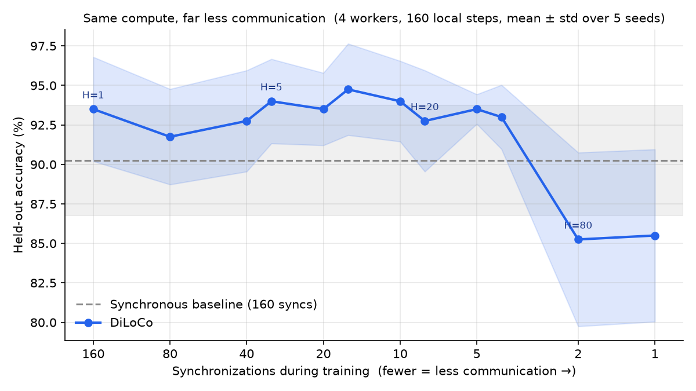
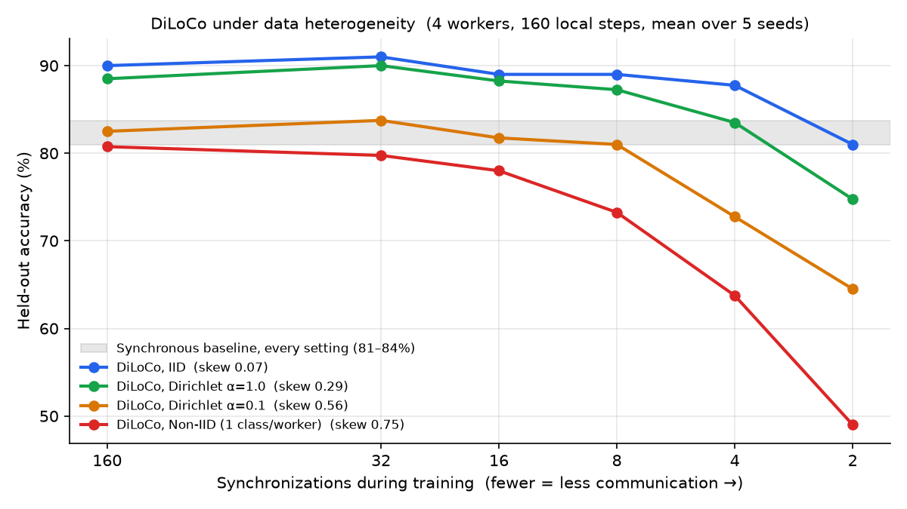
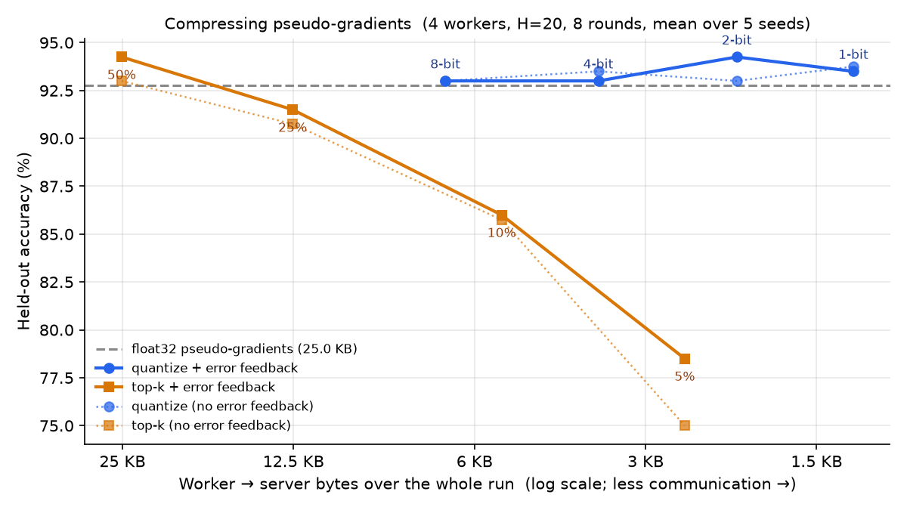
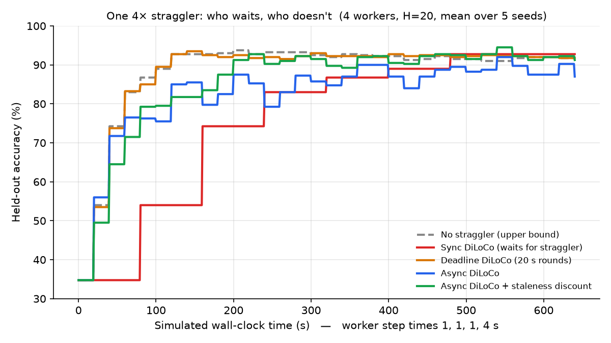
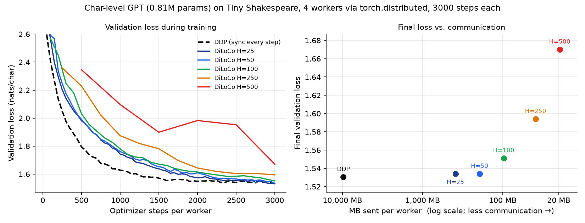
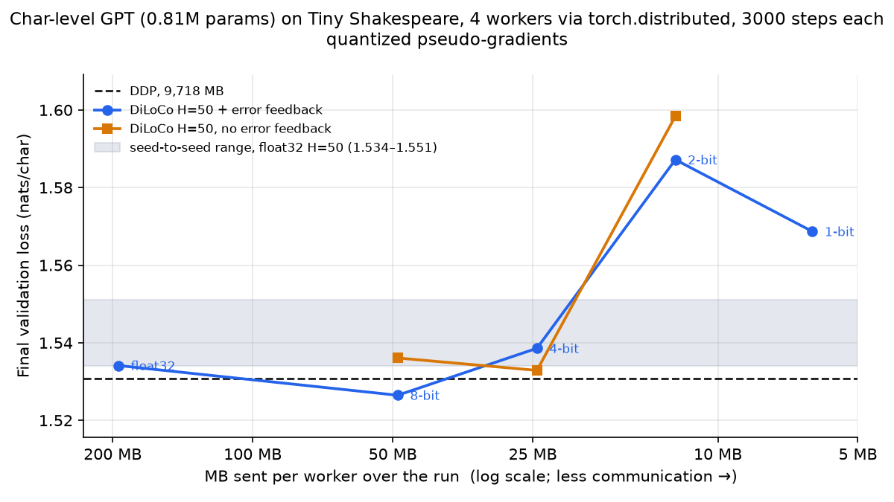
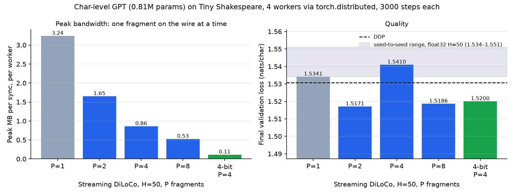
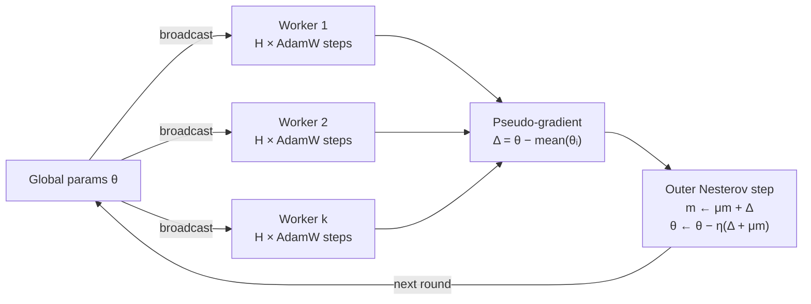

# DiLoCo from Scratch

**Distributed Low-Communication training from first principles: a pure-NumPy core with hand-written backprop and optimizers, research extensions with measured results, and a small PyTorch library (quantized + Streaming DiLoCo) that wraps any `nn.Module` and runs in Docker on CPU or NVIDIA GPUs.**

> Workers train on their own for many steps and sync only once per round. On a transformer LM trained by 4 processes over `torch.distributed`, that sends **50× less data than DDP for 0.2% higher validation loss** (1.5341 vs. 1.5308). 4-bit DiLoCo sends **397× less data than DDP** with validation loss inside run-to-run noise; over an emulated 100 Mbit/s link it reaches **1.64 in about the time DDP needs to reach 1.98**.


**[📖 Read the step-by-step build walkthrough →](https://soorya38.github.io/distributed-low-communication-training-of-language-models/)**

This repo reimplements the core algorithm from [DiLoCo: Distributed Low-Communication Training of Language Models](https://arxiv.org/abs/2311.08455) (Douillard et al., Google DeepMind, 2023) from first principles. Every gradient, optimizer moment, and parameter update is written by hand, so you can read exactly what the algorithm does. It then goes beyond the paper: what happens under non-IID data, with compressed or quantized pseudo-gradients, with Streaming DiLoCo's staggered fragment syncs, with straggling or asynchronous workers, and over a slow network. The DiLoCo logic is packaged as a library you can [drop into your own training loop](#use-diloco-with-your-own-model). Each question is answered with a reproducible experiment and real numbers.

---

## Why this matters

Data-parallel training usually all-reduces gradients **after every step**. That only works when every accelerator sits on the same fast interconnect. DiLoCo drops that requirement:

- Each worker runs **H local AdamW steps** with no communication at all.
- Workers then share one **pseudo-gradient** (how far their weights moved), and a **Nesterov-momentum outer optimizer** applies it to the global model.
- Communication drops by a factor of **H** while model quality holds up.

This is the idea behind training across loosely connected clusters, spare capacity, or different data centers.

## Results



### Sweeping H: how rarely can workers sync?

`python experiments/sweep_h.py` fixes the compute budget at 160 local steps per worker and varies only how often workers sync. Each point is averaged over 5 seeds.

| Inner steps H | Syncs | Communication saved | DiLoCo accuracy |
|---:|---:|---:|---:|
| 1 | 160 | 1× | 93.5% ± 3.3 |
| 5 | 32 | 5× | 94.0% ± 2.7 |
| 10 | 16 | 10× | 94.8% ± 2.9 |
| 20 | 8 | 20× | 92.8% ± 3.2 |
| 40 | 4 | **40×** | **93.0% ± 2.0** |
| 80 | 2 | 80× | 85.3% ± 5.5 |
| *Sync baseline* | *160* | *—* | *90.3% ± 3.5* |

**DiLoCo stays at or above the synchronous baseline up to 40× less communication.** It only breaks down when workers sync just once or twice in the whole run, because they drift too far apart for one averaged step to recover. That trade-off between H and quality matches what the paper reports at scale.

### Single run

From `python scaffold.py`: 4 workers, 8 rounds × 20 inner steps, a 2-layer MLP, synthetic 3-class data, and an 80-sample held-out split.

| Method | Syncs | Scalars communicated | Eval loss | Eval accuracy |
|---|---:|---:|---:|---:|
| Synchronous data-parallel (all-reduce every step) | 160 | 249,600 | 0.2695 | 88.75% |
| **DiLoCo** (sync every 20 steps) | **8** | **12,480** | **0.2593** | **90.00%** |

**20× less communication, with equal or slightly better accuracy.** DiLoCo's mean worker training loss falls from 0.073 to 0.042 over the last three rounds.

> Scope: the NumPy core is a small, transparent reference implementation on a tiny MLP and synthetic data, so the whole algorithm fits in your head and runs in under a second. The [PyTorch port](#4-scaling-up-a-transformer-lm-with-torchdistributed) below runs the same algorithm on a real transformer language model.

## Beyond the paper: extensions

All numbers below come from the scripts in [`experiments/`](experiments) and [`torch_diloco/`](torch_diloco). Re-run any of them to regenerate the table and chart.

### 1. IID vs. non-IID data: where DiLoCo breaks



`python experiments/sharding.py`: 4 workers, 4 classes, 160 local steps per worker, 5 seeds. Shards range from IID through Dirichlet label skew to fully non-IID, where each worker only ever sees one class. *Skew* is the mean total-variation distance between a worker's label mix and the global mix (0 = identical, 0.75 = disjoint for 4 classes).

| Sharding | Skew | Sync baseline | DiLoCo H=1 | H=5 | H=20 | H=40 | H=80 |
|---|---:|---:|---:|---:|---:|---:|---:|
| IID | 0.07 | 82.8% | 90.0% | 91.0% | 89.0% | 87.8% | 81.0% |
| Dirichlet α=1.0 | 0.29 | 83.8% | 88.5% | 90.0% | 87.2% | 83.5% | 74.8% |
| Dirichlet α=0.1 | 0.56 | 81.0% | 82.5% | 83.8% | 81.0% | 72.8% | 64.5% |
| Non-IID (1 class/worker) | 0.75 | 82.2% | 80.8% | 79.8% | 73.2% | 63.8% | 49.0% |

**Synchronous training barely notices label skew (81–84% in every setting), because it averages gradients every step. DiLoCo's tolerance for long inner loops shrinks as skew grows.** With IID data it holds up to H=40. With one class per worker it is already 9 points below the synchronous baseline at H=20 (73.2% vs. 82.2%) and falls to 49% at H=80: each worker drifts toward a classifier for its own class, and averaging those models no longer gives a good global model. In practice, the more heterogeneous your workers' data, the more often they need to sync.

### 2. Compressing pseudo-gradients: another 19× on top



`python experiments/gradient_compression.py`: the headline setup (4 IID workers, H=20, 8 rounds), but each worker compresses its pseudo-gradient before sending it. Bytes are worker → server traffic over the whole run, including per-tensor scales and top-k indices. 5 seeds; EF = error feedback.

| Pseudo-gradient encoding | Bytes up | Smaller than float32 | Accuracy |
|---|---:|---:|---:|
| float32 (DiLoCo as published) | 24,960 | 1.0× | 92.8% ± 3.2 |
| 8-bit + EF | 6,752 | 3.7× | 93.0% ± 3.3 |
| 4-bit + EF | 3,632 | 6.9× | 93.0% ± 3.0 |
| 2-bit + EF | 2,072 | 12.0× | 94.3% ± 3.0 |
| **1-bit (sign × mean) + EF** | **1,292** | **19.3×** | **93.5% ± 1.7** |
| top 50% + EF | 25,088 | 1.0× | 94.3% ± 1.9 |
| top 25% + EF | 12,544 | 2.0× | 91.5% ± 0.9 |
| top 10% + EF | 5,376 | 4.6× | 86.0% ± 7.3 |
| top 5% + EF | 2,560 | 9.8× | 78.5% ± 5.4 |

**Quantization is nearly free: even 1-bit pseudo-gradients match float32 accuracy, sending 19.3× fewer bytes.** Combined with DiLoCo's 20× fewer syncs, that is about 386× less worker → server traffic than synchronous training. Top-k does much worse at the same byte budget. Every kept value also costs a 4-byte index, so top-50% saves nothing, and dropping 95% of each update costs 14 points. Error feedback recovers 3.5 points at top-5% (78.5% vs. 75.0%). At these bit widths it makes no measurable difference for quantization.

### 3. Stragglers and asynchronous updates



`python experiments/stragglers.py`: 4 IID workers with step times of 1, 1, 1 and **4** simulated seconds (one straggler), H=20, a 640 s budget, 5 seeds.

| Strategy | Acc @ 160 s | Acc @ 640 s | Time to 90% | Outer updates | Worker utilization |
|---|---:|---:|---:|---:|---:|
| No straggler (upper bound) | 92.8% | 92.2% | 120 s | 32 | 100% |
| Sync DiLoCo (waits for straggler) | 74.2% | 92.8% | 480 s | 8 | **44%** |
| **Deadline DiLoCo** (20 s rounds, straggler sends partial work) | **92.5%** | 91.8% | **120 s** | 32 | 100% |
| Async DiLoCo | 79.8% | 87.0% | 360 s | 104 | 100% |
| Async DiLoCo + 1/(1+staleness) discount | 83.5% | 91.2% | 200 s | 104 | 100% |

- **Plain DiLoCo leaves the fast workers idle 56% of the time** and takes 4× longer than the straggler-free run to reach 90%.
- **Deadline rounds recover the upper bound** (90% in 120 s, same as no straggler). The straggler sends the 5 steps it finished, weighted by its step count.
- **Fully asynchronous updates also never wait, but stale pushes hurt.** Pushes arrive an average of 2.9 updates late, and applying them with Nesterov momentum at full strength leaves the model at 87.0%. Discounting each push by 1/(1+staleness) recovers 91.2%. Bounded-staleness rounds beat free-running async here, consistent with what [Liu et al. (2024)](https://arxiv.org/abs/2401.09135) report for async Local-SGD on language models.

### 4. Scaling up: a transformer LM with `torch.distributed`



`python torch_diloco/compare.py`: a 0.81M-parameter character-level GPT (4 layers, d=128, 4 heads, context 64) trained on Tiny Shakespeare by **4 real worker processes** that talk over `torch.distributed` (gloo). Each worker trains on its own contiguous quarter of the text. Every run does 3,000 AdamW steps per worker at batch 32, so all runs see the same tokens and do the same compute. DDP is PyTorch's `DistributedDataParallel`. DiLoCo keeps each worker's AdamW state across rounds, all-reduces the float32 pseudo-gradient every H steps, and applies it with `SGD(lr=0.7, momentum=0.9, nesterov=True)`.

| Run | Syncs | Data sent per worker | Less than DDP | Val loss (nats/char) | Perplexity |
|---|---:|---:|---:|---:|---:|
| DDP (all-reduce every step) | 3,000 | 9,718 MB | 1× | 1.5308 | 4.62 |
| DiLoCo H=25 | 120 | 389 MB | 25× | 1.5342 | 4.64 |
| **DiLoCo H=50** | **60** | **194 MB** | **50×** | **1.5341** | **4.64** |
| DiLoCo H=100 | 30 | 97 MB | 100× | 1.5512 | 4.72 |
| DiLoCo H=250 | 12 | 39 MB | 250× | 1.5942 | 4.92 |
| DiLoCo H=500 | 6 | 19 MB | 500× | 1.6702 | 5.31 |

**On a real transformer LM, DiLoCo sends 50× less data for a 0.2% higher validation loss (1.5341 vs. 1.5308), and 100× less for 1.3% higher.** Past that the gap widens: syncing only 6 times in 3,000 steps costs 9%. That shape matches the NumPy H sweep above.

A sample from the H=50 model (prompt `ROMEO:`, temperature 0.8):

```
ROMEO:
The mortal sweetly did called and all the strength
As we had the enemy that in this servant:
Personation to his person.

COMINIUS:
We are the solempt of the right is here.

POLIXENES:
Why,
I cannot a mother power will moon, he shall be our dealth.
```

> Caveats: one seed per run. All 4 processes run on one laptop CPU, so communication is nearly free here and wall-clock times are similar (DDP 113 s, DiLoCo 99–107 s). Bytes are counted as the all-reduce payload per worker, the same way for both methods, so the ratios are exact. The real-world speedup depends on your network, and that measurement is the next item on the list below.

### 5. Quantized pseudo-gradients in PyTorch: 4× to 8× more, at no measured cost



`python torch_diloco/compare.py --study quant`: the LM above with DiLoCo H=50, but each worker sends its pseudo-gradient as blockwise k-bit codes (one float32 scale per 1,024 values, bit-packed into `uint8`). Integer codes can't be summed by `all_reduce`, so workers `all_gather` the packed payloads and every rank decodes and averages them in the same order. The global params stay bit-identical on every rank, and the tests check that.

To tell real effects from noise, I re-ran plain float32 DiLoCo H=50 with three seeds: **1.5341, 1.5402, 1.5512 (a 0.017-nat spread)**. That range is the shaded band in the chart.

| Pseudo-gradient | MB sent / worker | vs. float32 DiLoCo | vs. DDP | Val loss, with error feedback | without |
|---|---:|---:|---:|---:|---:|
| float32 | 194.4 | 1× | 50× | 1.5341 | — |
| 8-bit | 48.8 | 4.0× | 199× | 1.5265 | 1.5361 |
| **4-bit** | **24.5** | **7.9×** | **397×** | **1.5386** | **1.5329** |
| 2-bit | 12.3 | 15.8× | 788× | 1.5872 | 1.5984 |
| 1-bit (sign × block mean) | 6.3 | 30.9× | 1,551× | 1.5687 | — |

**8-bit and 4-bit pseudo-gradients land inside the float32 seed range, so 4-bit DiLoCo trains this LM sending 397× less data than DDP with no measurable quality loss.** At 2 bits and below the loss moves above the noise band: 1.5687 at 1 bit and 1.587–1.598 at 2 bits, against a band top of 1.551. With and without error feedback, the results differ by less than the seed noise at every bit width, so this run can't show a benefit from error feedback. The transformer is more sensitive to aggressive quantization than the NumPy MLP was, where even 1 bit was free.

### 6. Streaming DiLoCo: peak bandwidth down 2–30×



`python torch_diloco/compare.py --study streaming`: following [Streaming DiLoCo](https://arxiv.org/abs/2501.18512), the parameters are split into P contiguous fragments of roughly equal size. Fragment p syncs every H=50 steps, offset by p·50/P steps, so only one fragment is on the wire at a time. Total traffic is unchanged; the burst size shrinks.

| Fragments | Sync events | MB sent / worker | Peak MB per sync | Peak vs. DiLoCo | Val loss |
|---|---:|---:|---:|---:|---:|
| P=1 (plain DiLoCo) | 60 | 194.4 | 3.239 | 1× | 1.5341 |
| P=2 | 120 | 194.4 | 1.652 | 2.0× | 1.5171 |
| P=4 | 240 | 194.4 | 0.859 | 3.8× | 1.5410 |
| P=8 | 480 | 194.4 | 0.528 | 6.1× | 1.5186 |
| **P=4 + 4-bit** | **240** | **24.5** | **0.108** | **30×** | **1.5200** |

**Streaming cuts the bandwidth a worker needs at any moment roughly P×, at no measured cost in quality.** Every streaming run lands within 0.02 nats of the float32 seed range (1.534–1.551), and none is worse. P=8 gets 6.1× instead of 8× because individual tensors (131K-value MLP matrices) can't be split evenly eight ways. Combined with 4-bit quantization, each sync is a **108 KB burst, 30× smaller than plain DiLoCo's 3.2 MB**, and total traffic is 396× below DDP. The paper also overlaps each fragment's communication with the following compute steps. This implementation syncs fragments in place.

### 7. Real wall-clock time over a slow link

`sh docker/wan_benchmark.sh`: two Docker containers, each running 2 worker processes (4 workers total), train the LM above over the Docker network. `tc netem` throttles traffic between the containers to **100 Mbit/s with 20 ms delay**. Traffic inside each container is unthrottled, like fast intra-node and slow inter-node links in a real cluster. Times are measured, not simulated.

| Run | Link | Steps | MB sent / worker | Wall time | Val loss |
|---|---|---:|---:|---:|---:|
| DDP | unthrottled | 300 | 971.8 | 35.0 s | 1.9788 |
| DDP | 100 Mbit/s, 20 ms | 300 | 971.8 | **188.0 s** | 1.9788 |
| DiLoCo H=50 | 100 Mbit/s, 20 ms | 300 | 19.4 | 33.2 s | 2.1747 |
| DiLoCo H=50, 4-bit | 100 Mbit/s, 20 ms | 300 | 2.4 | 34.6 s | 2.1697 |
| **DiLoCo H=50, 4-bit** | 100 Mbit/s, 20 ms | **1,600** | 13.1 | **209.1 s** | **1.6433** |

- **The slow link makes DDP 5.4× slower** (35.0 s → 188.0 s for the same 300 steps). **DiLoCo on the slow link runs as fast as DDP on an unthrottled one** (33.2 s), so the network stops being the bottleneck.
- Step for step, DiLoCo is behind this early in training (2.17 vs. 1.98 at step 300), the same pattern as the loss curves in section 4. The fair comparison is quality per unit of wall-clock time: **in 209 s, about the time DDP spends on 300 steps, 4-bit DiLoCo completes 1,600 steps and reaches 1.643, against DDP's 1.979.**
- Caveats: all containers share one laptop, and the link is emulated with `tc netem`, not a real WAN. Each configuration ran once.

## The algorithm



Each round:

1. **Broadcast:** every worker starts from the current global params θ.
2. **Inner loop:** each worker runs `H` AdamW steps on its own shard (bias-corrected moments, decoupled weight decay).
3. **Outer gradient:** `Δ = θ − average(θ_1, …, θ_k)`.
4. **Outer update:** Nesterov momentum: `m ← μ·m + Δ`, then `θ ← θ − η·(Δ + μ·m)`.

Communication per round is one parameter-sized message per worker in each direction, against one per **step** for the synchronous baseline.

## Quickstart

```bash
git clone https://github.com/soorya38/distributed-low-communication-training-of-language-models.git
cd distributed-low-communication-training-of-language-models
pip install -r requirements.txt

python scaffold.py                          # end-to-end demo: DiLoCo vs. sync baseline
python -m unittest discover tests           # 60 unit tests (torch tests skip without PyTorch)

python experiments/sweep_h.py               # each script regenerates its chart in docs/assets/
python experiments/sharding.py
python experiments/gradient_compression.py
python experiments/stragglers.py

python torch_diloco/train_lm.py --mode diloco --inner-steps 100   # one LM run, 4 processes
python torch_diloco/compare.py --study h    # or: quant, streaming (~2 min per run on a laptop CPU)
sh docker/wan_benchmark.sh                  # DDP vs. DiLoCo over an emulated 100 Mbit/s link (needs Docker)
```

## Use DiLoCo with your own model

The [`diloco`](diloco) package wraps **any** PyTorch model and **any** inner optimizer. Keep your training loop and add one call after each optimizer step:

```bash
pip install "git+https://github.com/soorya38/distributed-low-communication-training-of-language-models.git"
```

```python
from diloco import DiLoCo, init_distributed

rank, world_size, device = init_distributed()      # under torchrun: NCCL on GPUs, gloo on CPU
torch.manual_seed(0)                               # every worker starts from the same weights
model = MyModel().to(device)
inner_opt = torch.optim.AdamW(model.parameters(), lr=3e-4)
diloco = DiLoCo(model, inner_steps=50,             # sync every 50 steps
                quantize_bits=4,                   # optional: 4-bit pseudo-gradients + error feedback
                num_fragments=4)                   # optional: Streaming DiLoCo, 4 staggered fragments

for x, y in my_shard_of_the_data:
    loss_fn(model(x), y).backward()
    inner_opt.step()
    inner_opt.zero_grad()
    diloco.step()                                  # syncs when due; no-op otherwise

with diloco.global_weights():                      # evaluate or save the shared model
    evaluate(model)
print(diloco.stats)                                # syncs, bytes sent, peak bytes per sync, comm time
```

[`examples/custom_model.py`](examples/custom_model.py) is a complete runnable version with a different model (an MLP fitting a nonlinear function), each worker drawing its own data:

```bash
torchrun --nproc-per-node=2 examples/custom_model.py
# step 1000  val mse 0.0028   (noise floor 0.0025)
# workers=2 device=cpu syncs=80 sent=0.41 MB/worker peak=9.8 KB/sync
```

## Run with Docker (CPU or NVIDIA GPU)

One `Dockerfile` builds a CPU image (`python:3.12-slim` + CPU PyTorch, 1.09 GB) or a GPU image (`pytorch/pytorch:2.14.1-cuda12.6-cudnn9-runtime`). The code detects CUDA at runtime and uses NCCL on GPUs, or gloo on CPU. Containers drop root and run as an unprivileged user.

```bash
# one container, 4 worker processes
docker build -t diloco:cpu .
docker run --rm diloco:cpu

# two containers ("machines") training one model over the network with torchrun
docker compose up --build
TRAIN_ARGS="--mode diloco --inner-steps 50 --quantize-bits 4 --steps 500 --eval-interval 50 --out results/q4.json" \
  docker compose up

# emulate a slow link between the machines (tc netem inside each container)
NET_DELAY=20ms NET_RATE=100mbit docker compose up

# NVIDIA GPUs (needs the NVIDIA Container Toolkit)
docker compose -f compose.yaml -f compose.gpu.yaml up --build
```

Across real machines, run the same image on each host with `--network host` (add `--gpus all` on GPU hosts) and point torchrun at the first one:

```bash
docker run --rm --network host --gpus all diloco:gpu \
  torchrun --nnodes=2 --nproc-per-node=8 --rdzv-backend=c10d --rdzv-endpoint=HOST0:29400 --rdzv-id=job1 \
  torch_diloco/train_lm.py --mode diloco --inner-steps 500 --quantize-bits 4 --steps 20000
```

> The CPU image and the two-container compose setup were run end to end while building this repo. The GPU path (CUDA image, NCCL backend) follows the same code but has **not been tested on real NVIDIA hardware** here.

## What's implemented

The core is [`model.py`](model.py), built bottom-up from 30 small, tested functions:

| Layer | Components |
|---|---|
| **Model** | 2-layer MLP init, ReLU, forward pass with cached activations, numerically stable softmax and log-sum-exp cross-entropy, **hand-derived backprop** |
| **Inner optimizer** | AdamW from scratch: first and second moments, bias correction, adaptive step, **decoupled** weight decay |
| **Param algebra** | clone, scale, subtract, average over parameter pytrees (dicts of arrays) |
| **Data** | IID sharding, **non-IID** label-skewed sharding, per-worker minibatch sampling |
| **Worker** | single local step, full `H`-step inner loop with per-worker optimizer state |
| **Outer optimizer** | momentum buffer, Nesterov update, pseudo-gradient computation |
| **Training** | one DiLoCo round, the multi-round DiLoCo loop, a synchronous data-parallel baseline with the same compute |
| **Analysis** | eval loss, accuracy, communication accounting (scalars sent and savings factor) |

[`extensions.py`](extensions.py) builds on it:

| Extension | Components |
|---|---|
| **Heterogeneity** | Dirichlet label-skew sharding, a label-skew metric |
| **Compression** | k-bit quantization (down to 1-bit sign × mean), top-k sparsification, per-worker error feedback, exact byte accounting |
| **Systems** | deadline-based rounds with step-weighted averaging, event-driven asynchronous DiLoCo with staleness tracking and discounting, all on a simulated wall clock |

The [`diloco`](diloco) package is the PyTorch implementation, usable with any model: the `DiLoCo` wrapper, blockwise k-bit quantization with bit-packing and error feedback, Streaming DiLoCo fragments, and process-group setup for torchrun or `mp.spawn` (NCCL on GPUs, gloo on CPU). [`torch_diloco/train_lm.py`](torch_diloco/train_lm.py) uses it to train a minimal GPT in DDP or DiLoCo mode.

## Engineering notes

- **Pure functional updates.** Optimizer steps return new parameter dicts instead of mutating shared state, which prevents accidental aliasing between workers and the global model.
- **Numerical stability.** Softmax subtracts the row max, and cross-entropy uses log-sum-exp, so logits of 1000+ don't overflow (covered by tests).
- **Fair baseline.** The synchronous run does the same number of gradient computations (`rounds × H` steps across all workers), so the comparison isolates communication frequency.
- **Deterministic.** Every source of randomness is seeded, so runs reproduce exactly.
- **Cross-checked.** The extension code reproduces `train_diloco` bit-for-bit when compression is off or every worker is equally fast, so each new feature is tested against the reference implementation.
- **Tested.** 60 unit tests cover shapes, determinism, gradient correctness, optimizer math, sharding invariants, compression error bounds and byte counts, error-feedback bookkeeping, async event ordering and staleness, bit-packing round trips, fragment schedules, and real 2-process `torch.distributed` runs. Those runs check that every rank ends up with bit-identical global params in float32, quantized and streaming modes.
- **Refactor-safe.** Moving the PyTorch DiLoCo logic into the `diloco` library reproduced the earlier LM runs exactly: same validation losses, bytes, sync counts and generated text.

## Project layout

```
model.py                   # core DiLoCo in NumPy (30 functions)
extensions.py              # non-IID sharding, compression, stragglers, async
scaffold.py                # end-to-end demo and comparison
experiments/               # one script per study; each writes a chart to docs/assets/
diloco/                    # PyTorch library: DiLoCo wrapper, quantization, streaming fragments, dist setup
examples/custom_model.py   # adding DiLoCo to your own training loop
torch_diloco/train_lm.py   # char-level GPT, DDP vs. DiLoCo over torch.distributed
torch_diloco/compare.py    # LM studies (H, quantization, streaming); raw results in torch_diloco/results/
Dockerfile, compose*.yaml  # CPU and NVIDIA GPU images, two-container training over the network
docker/wan_benchmark.sh    # wall-clock benchmark over an emulated slow link
tests/                     # unit tests for all of the above
docs/index.html            # walkthrough of how the core was built (GitHub Pages)
```

## Possible extensions

- [x] Sweep `H` (inner steps) and plot accuracy against communication
- [x] Compare IID and non-IID sharding head-to-head
- [x] Port to PyTorch with `torch.distributed` and train a small transformer LM
- [x] Compress pseudo-gradients (quantization, top-k) on top of DiLoCo
- [x] Asynchronous and straggler-tolerant outer updates
- [x] Quantized pseudo-gradients in the PyTorch port
- [x] Streaming DiLoCo: sync parameter fragments on a staggered schedule
- [x] Reusable library for any PyTorch model, plus Docker images for CPU and NVIDIA GPUs
- [x] Wall-clock benchmark over an emulated slow network link
- [ ] Run across real machines on GPUs (NCCL) and measure wall-clock savings at scale
- [ ] Overlap streaming fragment communication with compute, as in the Streaming DiLoCo paper

## References

- Douillard et al., *DiLoCo: Distributed Low-Communication Training of Language Models*, 2023. [arXiv:2311.08455](https://arxiv.org/abs/2311.08455)
- Loshchilov & Hutter, *Decoupled Weight Decay Regularization* (AdamW), 2019. [arXiv:1711.05101](https://arxiv.org/abs/1711.05101)
- Jaghouar et al., *OpenDiLoCo*, 2024. [arXiv:2407.07852](https://arxiv.org/abs/2407.07852)
- Douillard et al., *Streaming DiLoCo with overlapping communication: Towards a Distributed Free Lunch*, 2025. [arXiv:2501.18512](https://arxiv.org/abs/2501.18512)
- Liu et al., *Asynchronous Local-SGD Training for Language Modeling*, 2024. [arXiv:2401.09135](https://arxiv.org/abs/2401.09135)
- Karimireddy et al., *Error Feedback Fixes SignSGD and other Gradient Compression Schemes*, 2019. [arXiv:1901.09847](https://arxiv.org/abs/1901.09847)
- Hsu et al., *Measuring the Effects of Non-Identical Data Distribution for Federated Visual Classification* (Dirichlet sharding), 2019. [arXiv:1909.06335](https://arxiv.org/abs/1909.06335)

## License

[MIT](LICENSE)

---

If this helped you understand low-communication training, consider giving it a ⭐.
